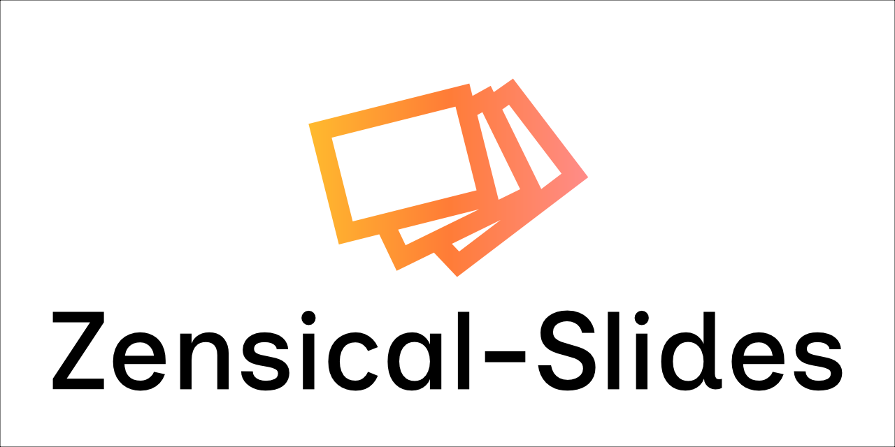
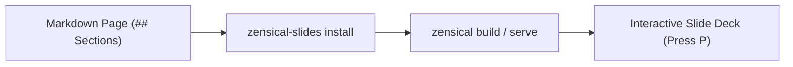

<!-- markdownlint-disable MD033 -->

# Introduction

<p align="center">
  <picture>
    <source media="(prefers-color-scheme: dark)" srcset="assets/logotype_white.png">
    <source media="(prefers-color-scheme: light)" srcset="assets/logotype_black.png">
    
  </picture>
</p>

<span class="md-typeset-planned"> A large part of the problem of communication is with the introduction. If you want people to look at things from a certain point of view, or to appreciate certain aspects of your work, then you need to present this clearly at the start of the project.</span>

`zensical-slides` turns any Zensical or MkDocs page into a slide deck directly in the browser. Click the **▶ Show** button in the bottom-right corner or press ++p++ to test presentation mode on this page.

## How slide grouping works

When presentation mode starts, the script groups the article content by `<h2>` (`##`) headings:

- Everything before the first `##` heading forms the opening slide.
- Each `##` heading starts a new slide and includes all following elements until the next `##` heading.
- State is preserved across page reloads (F5), and URLs synchronize with `?slide=N` for direct slide linking.
- Exiting presentation mode scrolls smoothly to the section you were viewing and clears `?slide` from the URL.

<p class="apresentador">Speaker note (.apresentador): This paragraph uses the muted presenter style so you can keep talking points on screen without distracting from the primary text.</p>

## Keyboard and button controls

You can move between slides using the on-screen buttons or keyboard shortcuts:

| Action | Shortcut | UI Control |
| :--- | :--- | :--- |
| Toggle presentation mode | ++p++ | **▶ Show** / **✕ Exit** |
| Next slide | ++arrow-right++, ++page-down++, or ++space++ | Right arrow (`›`) |
| Previous slide | ++arrow-left++ or ++page-up++ | Left arrow (`‹`) |
| Jump to slide | Click on progress bar | Progression bar (top or bottom) |
| Toggle fullscreen | ++f++ | Fullscreen button (`⛶`) |
| Exit presentation mode | ++escape++ | **✕ Exit** |

## Installation

### Option 1: Direct URL (Recommended for now, no installation required)

Because Zensical does not have an official public plugin API module system yet, including minified assets via CDN is the quickest way to get started. No Python package installation is needed.

Add the assets to `zensical.toml` (or `mkdocs.yml`):

**Latest version:**

```toml
[project]
extra_css = [
	"https://cdn.jsdelivr.net/gh/BeyondMagic/zensical-slides@latest/dist/zensical-slides.min.css",
]
extra_javascript = [
	"https://cdn.jsdelivr.net/gh/BeyondMagic/zensical-slides@latest/dist/zensical-slides.min.mjs",
]
```

**Versioned (pinned):**

```toml
[project]
extra_css = [
	"https://cdn.jsdelivr.net/gh/BeyondMagic/zensical-slides@1.0.8/dist/zensical-slides.min.css",
]
extra_javascript = [
	"https://cdn.jsdelivr.net/gh/BeyondMagic/zensical-slides@1.0.8/dist/zensical-slides.min.mjs",
]
```

### Option 2: Markdown Extension (MkDocs and Zensical)

Install the Python package:

```sh
pip install zensical-slides
```

Enable `zensical_slides` in your markdown extensions. This works in both standard MkDocs and Zensical, bundling and inlining assets directly with full offline support.

In `zensical.toml`:

```toml
[project.markdown_extensions.zensical_slides]
progress_bar = "top"  # "top" (default), "bottom", or "none"
language = "en"       # "en" (default), "ja", or "pt"
assets = "local"      # "local" (default, bundled offline), "cdn", or "none"
```

In `mkdocs.yml`:

```yaml
markdown_extensions:
  - zensical_slides:
      progress_bar: top
      language: en
      assets: local
```

### Option 3: Local CLI Installer (`zensical-slides install`)

This method copies assets into your project's `docs_dir` and registers them in `zensical.toml`. It is provided now for compatibility and ahead of future official Zensical module API support.

```sh
pip install zensical-slides
zensical-slides install
```

The installer copies `logic.mjs` and `ui.css` into `<docs_dir>/assets/plugin/zensical-slides/` and adds them to `zensical.toml`:

```toml
[project]
extra_css = [
	"assets/plugin/zensical-slides/ui.css",
]
extra_javascript = [
	"assets/plugin/zensical-slides/logic.mjs",
]
```

When using Option 3, re-run `zensical-slides install` whenever you change settings in `[project.theme]` or `[project.extra.slides]`.

## Configuration

Depending on your installation method:

- **Option 1 (Direct URL)**: Configure the language via `[project.theme]` (`language = "en"`) or HTML document `lang` attributes.
- **Option 2 (Markdown Extension)**: Configure settings directly under `[project.markdown_extensions.zensical_slides]` in `zensical.toml` (or `markdown_extensions` in `mkdocs.yml`).
- **Option 3 (CLI Installer)**: Configure settings in `[project.theme]` and `[project.extra.slides]`:

```toml
[project.theme]
language = "en" # "en" (English), "ja" (Japanese), or "pt" (Portuguese)

[project.extra.slides]
progress_bar = "top" # "top" (default), "bottom", or "none"
```

## Diagrams and callouts in slides

Presentation mode styles blockquotes, tables, code blocks, and initializes Mermaid diagrams when a page loads.

> Good documentation works both as a reference you read at your own pace and as a visual aid when walking a team through a decision.


