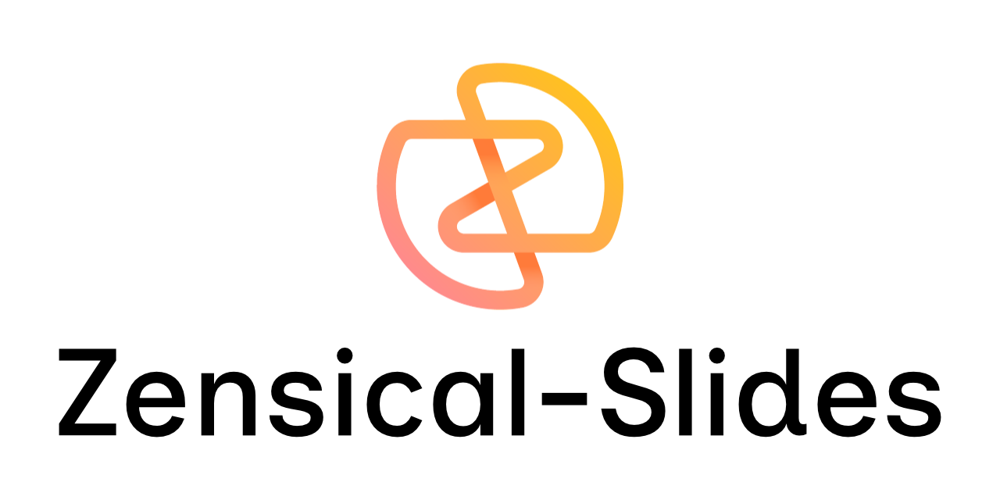
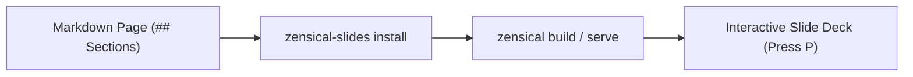

<!-- markdownlint-disable MD033 -->

# Introduction

<p align="center">
  <picture>
    <source media="(prefers-color-scheme: dark)" srcset="assets/logotype_white.png">
    <source media="(prefers-color-scheme: light)" srcset="assets/logotype_transparent.png">
    
  </picture>
</p>

<span class="md-typeset-planned"> A large part of the problem of communication is with the introduction. If you want people to look at things from a certain point of view, or to appreciate certain aspects of your work, then you need to present this clearly at the start of the project.</span>

`zensical-slides` turns any Zensical page into a slide deck directly in the browser. Click the **▶ Show** button in the bottom-right corner or press ++p++ to test presentation mode on this page.

## How slide grouping works

When presentation mode starts, the script groups the article content by `<h2>` (`##`) headings:

- Everything before the first `##` heading forms the opening slide.
- Each `##` heading starts a new slide and includes all following elements until the next `##` heading.
- Exiting presentation mode scrolls smoothly to the section you were viewing.

<p class="apresentador">Speaker note (.apresentador): This paragraph uses the muted presenter style so you can keep talking points on screen without distracting from the primary text.</p>

## Keyboard and button controls

You can move between slides using the on-screen buttons or keyboard shortcuts:

| Action | Shortcut | UI Control |
| :--- | :--- | :--- |
| Toggle presentation mode | ++p++ | **▶ Show** / **✕ Exit** |
| Next slide | ++arrow-right++, ++page-down++, or ++space++ | Right arrow (`›`) |
| Previous slide | ++arrow-left++ or ++page-up++ | Left arrow (`‹`) |
| Jump to slide | Click on progress bar | Progression bar (top or bottom) |
| Toggle fullscreen | ++f++ | Fullscreen button (`⛶`) |
| Exit presentation mode | ++escape++ | **✕ Exit** |

## Configuration

You can configure plugin options in `zensical.toml`:

```toml
[project.theme]
language = "en" # "en" (English), "ja" (Japanese), or "pt" (Portuguese)

[project.extra.slides]
progress_bar = "top" # "top" (default), "bottom", or "none"
```

Re-run `zensical-slides install` whenever changing configuration settings to regenerate the client configuration.

## Installation

Install the package with `pip` and run the CLI installer inside your project directory:

```sh
pip install zensical-slides
zensical-slides install
```

The installer copies `logic.mjs` and `ui.css` into `<docs_dir>/assets/plugin/zensical-slides/` and registers them in `zensical.toml`:

```toml
[project]
extra_css = [
	"assets/plugin/zensical-slides/ui.css",
]
extra_javascript = [
	"assets/plugin/zensical-slides/logic.mjs",
]
```

## Diagrams and callouts in slides

Presentation mode styles blockquotes, tables, code blocks, and initializes Mermaid diagrams when a page loads.

> Good documentation works both as a reference you read at your own pace and as a visual aid when walking a team through a decision.


